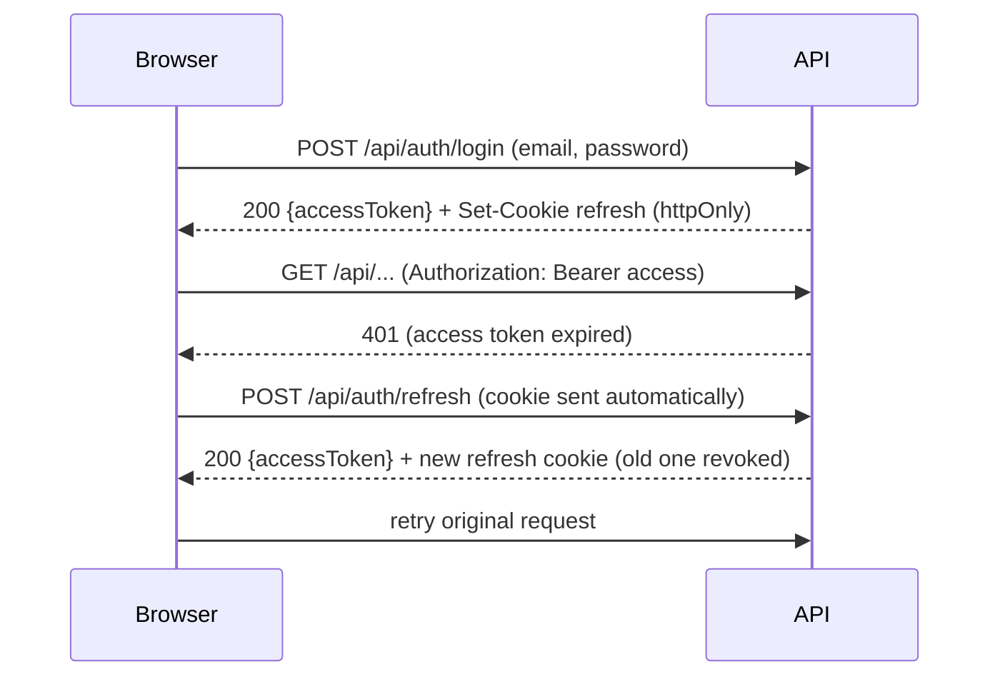
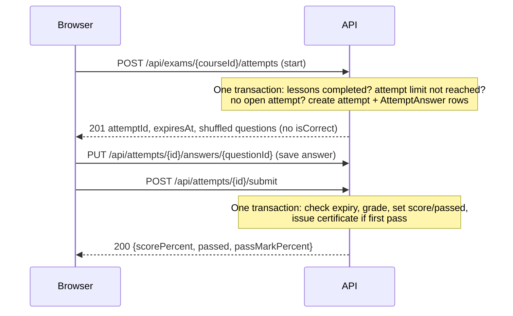

# LearnHub: Architecture

Status: Draft

## 1. Overview

- One SPA, one API, one database. No microservices, no message queues.
- The API is stateless. All state is in PostgreSQL, so it can scale horizontally later.
- The browser sees a single origin: the API is reached through `/api`, so no CORS
  configuration is needed and the refresh cookie is first-party (ADR-005).

## 2. Architecture decisions

| ADR | Decision |
|---|---|
| 001 | ASP.NET Core Identity with JWT |
| 002 | Access token (15 min) + rotating refresh token (7 days) |
| 003 | Guid primary keys (UUIDv7 preferred) |
| 004 | EF Core code-first with migrations |
| 005 | Refresh token in an httpOnly cookie, access token in memory |
| 006 | Request validation approach (pending) |

## 3. Runtime topology

| Mode | Database | API | Frontend |
|---|---|---|---|
| Development | Docker (`docker-compose.yml`) | native, `dotnet watch` | native, `npm run dev` with proxy to the API |
| Production / demo | Docker | Docker | Docker (nginx: static files + `/api` proxy) |

Configuration comes from environment variables (`.env` locally, never committed).
`.env.example` documents every key.

| Key group | Examples |
|---|---|
| Database | connection string, DB user and password |
| Auth | JWT signing key, issuer, audience, token lifetimes |
| Seeding | Admin email and password |
| Exam | none required in the MVP (no cooldown) |

Secrets (DB password, JWT key, Admin credentials) are never hardcoded or committed.

## 4. Backend

### 4.1 Layers (single project, `LearnHub.Api`)

```
HTTP request
  → Middleware   (exception handling, rate limiting, authentication)
  → Controller   (HTTP only: bind, authorize, call service, map result to status code)
  → Service      (business rules, transactions, resource authorization)
  → AppDbContext (EF Core, PostgreSQL)
```

Rules:
1. Controllers contain no business logic and never touch `AppDbContext`.
2. Services depend on `AppDbContext` and on interfaces (`ICourseService`,
   `ITokenService`, `ICertificatePdfGenerator`, `ICurrentUser`).
3. Entities never leave the service layer. Services return DTOs.
4. Ownership checks (is this teacher the owner of the course?) live in services,
   not only in attribute-based authorization, because they need data.
5. Services get the current user through `ICurrentUser` (wraps `HttpContext`),
   so they stay testable.
6. No repository layer. `AppDbContext` is the unit of work.

### 4.2 Folder layout

```
LearnHub.Api/
├── Controllers/
├── Services/          # grouped by feature once it grows: Services/Courses/...
├── Entities/
├── Dtos/              # grouped by feature
├── Data/              # AppDbContext, Configurations/, Migrations/, Seed/
├── Validators/        # depends on the validation decision
├── Middleware/        # ExceptionHandlingMiddleware
├── Extensions/        # service registration, keeps Program.cs short
├── Program.cs
└── appsettings.json
```

### 4.3 Services

| Service | Responsibility |
|---|---|
| AuthService, TokenService | register, login, refresh with rotation and reuse detection, logout, JWT creation |
| CourseService | CRUD, publish/unpublish validation, browsing and filtering |
| LessonService | CRUD, reordering, video URL validation |
| EnrollmentService | enroll, list my courses, lesson completion, progress |
| ExamService | teacher side: manage exam settings, questions and answers, archive rules |
| AttemptService | student side: start, save answer, submit, grading, attempt limit, expiry |
| CertificateService | issue on pass, verify by code, revoke |
| CertificatePdfGenerator | QuestPDF rendering from the certificate record |
| AdminService | list and disable users, change roles, moderate courses and certificates |

### 4.4 Authorization

| Policy | Allowed roles |
|---|---|
| `CanLearn` | Student, Teacher |
| `CanTeach` | Teacher |
| `AdminOnly` | Admin |

- Controllers use `[Authorize(Policy = ...)]`.
- Resource ownership is checked in the service. When a user shouldn't know a
  resource exists, the API returns **404**, not 403.
- A deactivated user (`IsActive = false`) is rejected at login and at refresh.
  Existing access tokens expire within 15 minutes.
- Guids are not a security control. Every endpoint checks authorization.

### 4.5 Authentication flow



Token details (ADR-002, ADR-005):
- Access token: JWT, 15 minutes, `Authorization: Bearer`, kept in memory only.
- Refresh token: random value, 7 days. Only its SHA-256 hash is stored.
  Cookie flags: `HttpOnly; Secure; SameSite=Strict; Path=/api/auth`.
- Every refresh rotates the token (new token issued, old one revoked and linked
  through `ReplacedByTokenId`).
- **Reuse detection:** if a revoked token is presented outside a ~10 second grace
  window, the whole rotation chain for that user is revoked and the user must log in again.
- Logout revokes the token and clears the cookie.
- Disabling a user revokes all of their refresh tokens.

### 4.6 Attempt flow (exam)



Rules:
- **Start** runs in one transaction and checks: all lessons completed, no open
  attempt, and the attempt count is below `MaxAttempts` (when set). Every started
  attempt counts toward the limit, including Expired ones. Rows in `AttemptAnswer`
  are created for each active question, which fixes the question set.
- **Shuffle:** question and answer order are derived from `ShuffleSeed`, so a page
  refresh does not reshuffle.
- **Save answer** is allowed only while the attempt is `InProgress` and before `ExpiresAt`.
- **Submit** after `ExpiresAt` is rejected, and the attempt is stored as `Expired`
  (graded as submitted so far, or scored as failed, to be decided in the API doc).
- **Result visibility:** the submit response contains only score, pass/fail and the
  pass mark. Nothing at question level (see requirements, section 7).
- **Certificate:** issued inside the submit transaction on the first passing attempt.
  The unique `(StudentId, CourseId)` index prevents duplicates under concurrency.
- **Concurrency:** the partial unique index on open attempts blocks parallel starts,
  and the count check runs inside the start transaction.
- A student who already passed may retake the exam. The existing certificate is never replaced.

### 4.7 Error handling
- A global exception middleware converts exceptions into **RFC 9457 ProblemDetails**
  (`application/problem+json`).
- Services throw typed exceptions:

| Exception | HTTP status |
|---|---|
| `NotFoundException` | 404 |
| `ForbiddenException` | 403 |
| `ConflictException` | 409 |
| `ValidationException` | 400 (with field errors) |
| `BusinessRuleException` | 422 (e.g. "No attempts left", "Exam locked") |

- Unexpected errors return 500 with a generic message and a trace ID. Details go to the logs only.
- Validation errors return a field-to-messages dictionary, so the frontend can show them per field.

### 4.8 API conventions
- JSON, camelCase, ISO 8601 UTC dates, Guid IDs.
- REST-style routes under `/api`, for example `/api/courses/{id}/lessons`.
- Lists are paginated (`page`, `pageSize`, max 50) and return
  `{ items, page, pageSize, totalCount }`.
- Student-facing and teacher-facing exam DTOs are separate types.
  Only the teacher DTO contains `isCorrect`.
- Swagger/OpenAPI is enabled in development and acts as the live API reference.

### 4.9 Cross-cutting concerns

| Concern | Approach |
|---|---|
| Rate limiting | Built-in ASP.NET Core middleware. Strict on `/api/auth/*`, `/api/certificates/verify/*` and exam-start endpoints |
| Logging | Serilog, structured, to console. Never log passwords, tokens or answers |
| Health check | `/health` with a DB check, used by Docker Compose |
| Time | Services use `TimeProvider`, so expiry logic is testable |
| Transactions | Start attempt, submit attempt (with certificate issue) and refresh-token rotation each run in one transaction |
| Migrations | Applied automatically at startup in development only. In production they run as a one-off step (EF migrations bundle) |
| Seeding | Roles, categories and the Admin account, on startup. The Admin password comes from environment variables |
| Certificate PDF | QuestPDF, community license set at startup, rendered on demand from the certificate record |

## 5. Frontend

### 5.1 Structure (feature-based)

```
src/learnhub-web/src/
├── api/          # axios instance, interceptors, typed endpoint functions
├── app/          # router, providers (Auth, QueryClient), layouts
├── features/     # auth, courses, learning, exams, certificates, admin
│   └── <feature>/ { components, hooks, pages, api }
├── components/   # shared UI primitives (Button, Modal, Input...)
├── hooks/
├── lib/          # helpers (formatting, markdown rendering)
└── types/
```

### 5.2 Conventions
- **TanStack Query** for all server state. React state/context for the auth session only.
- **Axios** instance with `baseURL: '/api'` and `withCredentials: true`.
  - Request interceptor: attaches the in-memory access token.
  - Response interceptor: on 401, runs one shared in-flight refresh call, retries
    the original request once, and otherwise redirects to login.
- **Session start:** on app load, call `POST /api/auth/refresh`. If it succeeds,
  the user is signed in. Show a loading state until it completes.
- **Route guards:** `<RequireAuth roles={[...]}>` wraps protected routes. This is
  UX only. The API enforces the real rules.
- **Markdown** is rendered with a sanitizing renderer. Videos are embedded through an
  iframe built from the parsed video ID, never from the raw URL.
- **Errors:** a shared handler maps ProblemDetails to form field errors and toasts.
- **Exam UI:** shows a countdown from `expiresAt`. The server is the authority on
  time. The countdown is cosmetic.
- **Teacher UI:** the exam settings form shows a hint that unlimited attempts
  allow guessing by trial and error.

### 5.3 Main routes

| Route | Access |
|---|---|
| `/`, `/courses`, `/courses/:id` | public |
| `/verify/:code` | public |
| `/login`, `/register` | public |
| `/my-learning`, `/learn/:courseId`, `/exam/:courseId`, `/certificates` | Student, Teacher |
| `/teach`, `/teach/courses/:id` | Teacher |
| `/admin/users`, `/admin/courses`, `/admin/certificates` | Admin |

## 6. Docker and CI

- `docker-compose.yml` (development): PostgreSQL (+ optional pgAdmin) with a named volume.
- `docker-compose.prod.yml`: `db`, a one-off `migrate` service (EF migrations bundle),
  `api` (depends on `migrate`), and `web` (nginx).
- API image: multi-stage build, runs as a non-root user.
- Web image: Node build stage, then nginx serving the static files and proxying `/api`.
- Health checks: the db and the API both define one, and `api` waits for a healthy db.
- **GitHub Actions** on every pull request:
  1. `dotnet build` and `dotnet test`
  2. `npm ci`, lint, test and build
  3. Build the Docker images

## 7. Testing strategy

- **Unit tests** (service rules that carry risk): grading, attempt limit, attempt
  expiry, publish validation, refresh-token rotation and reuse detection, certificate code generation.
- **Integration tests:** controllers through `WebApplicationFactory`, against a real
  PostgreSQL (Testcontainers), because partial unique indexes and check constraints
  don't work on the in-memory provider.
- **Frontend:** component tests for the critical flows only (login, taking an exam).
- Critical authorization cases (a teacher accessing another teacher's course, a
  student reading `isCorrect`) get explicit integration tests.

## 8. Security summary

| Threat | Mitigation |
|---|---|
| XSS stealing credentials | Refresh token in httpOnly cookie, access token in memory, sanitized Markdown, iframe from parsed video ID |
| CSRF | `SameSite=Strict` cookie scoped to `/api/auth` |
| Token theft | 15 minute access tokens, rotation and reuse detection on refresh tokens |
| Brute force on login | ASP.NET Identity lockout, rate limiting |
| Certificate code guessing | Random 8-character code (~10^12 combinations), rate limiting, identical response for unknown codes |
| Answer leakage | Separate student DTOs without `isCorrect`, score-only results |
| Exam guessing by trial and error | Teacher-set attempt limit (default unlimited, a known trade-off documented in the UI) |
| Unauthorized access | Policies plus ownership checks in services, 404 for hidden resources |

## 9. Open items
- Request validation approach (FluentValidation vs DataAnnotations), to be recorded as ADR-006.
- Behaviour of a submit after expiry: grade the answers saved so far, or score as failed.